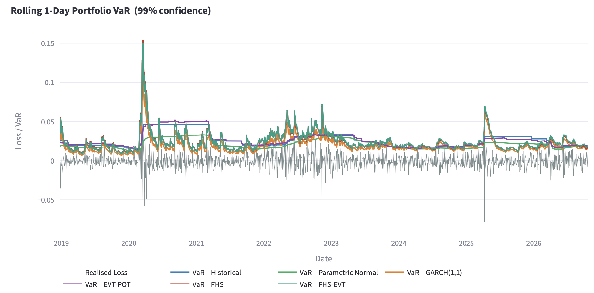
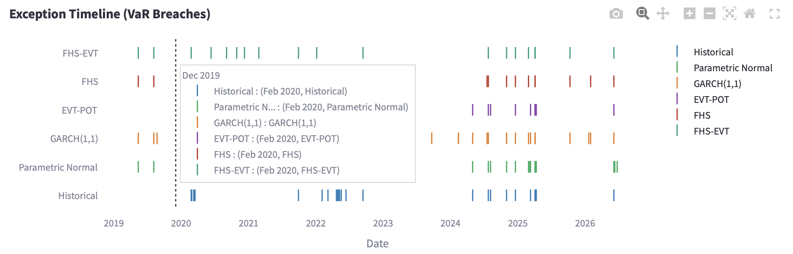

# Walk-forward VaR backtesting engine comparing Historical, Parametric, GARCH, EVT-POT, FHS and FHS-EVT on a multi-asset portfolio

An interactive Streamlit dashboard that estimates 1-day portfolio Value-at-Risk with six models, scores every model on the same out-of-sample days, and tests the results with Kupiec and Christoffersen backtests.



## Key findings

Portfolio: SPY 40% / QQQ 30% / TLT 20% / GLD 10%. Common backtest sample: ~1,965 trading days (24/12/2018 to 21/10/2026 or your current run date), identical for every model.
Walk-forward settings: window 1000 days, refit every 20 days, FHS-EVT threshold quantile 0.90. 

FHS and FHS-EVT are shown with the GJR leverage term off and on. The GJR-off setting was preferred only after seeing the test results, so both are reported.

| Model | 95%: exceptions (expected ~98) | 95%: CC p-value | 99%: exceptions (expected ~20) | 99%: CC p-value |
|---|---|---|---|---|
| Historical | 105 | 0.649 (pass) | 28 | 0.005 (fail) |
| Parametric Normal | 105 | 0.462 (pass) | 45 | <0.001 (fail) |
| GARCH(1,1) | 130 | 0.006 (fail) | 41 | <0.001 (fail) |
| EVT-POT | 97 | 0.835 (pass) | 25 | 0.007 (fail) |
| FHS (GJR off) | 105 | 0.592 (pass) | 21 | 0.452 (pass) |
| FHS-EVT (GJR off) | 103 | 0.442 (pass) | 19 | 0.397 (pass) |
| FHS (GJR on) | 110 | 0.427 (pass) | 23 | 0.415 (pass) |
| FHS-EVT (GJR on) | 105 | 0.360 (pass) | 24 | 0.369 (pass) |

CC = Christoffersen conditional coverage test, 5% significance level.

1. **At 99%, FHS and FHS-EVT are the only models that pass conditional coverage, with the GJR term on or off.** Their counts (19 to 24) are close to the ~20 expected, but EVT-POT (25) is nearly as close in count. What separates them is independence: EVT-POT (p = 0.003) and Historical (p = 0.007) fail the Christoffersen independence test, meaning their breaches cluster in time, while FHS and FHS-EVT do not (p = 0.22 and 0.18 with GJR off). Historical (28 exceptions) actually passes the Kupiec coverage test (p = 0.075) and fails only on independence.
2. **At 95%, five of six models pass and their counts are statistically indistinguishable** (97 to 110 against ~98 expected; the standard deviation of the count is ~9.7). Only GARCH(1,1) fails, on coverage (6.6% hit rate).
3. **GARCH(1,1) and FHS differ only in the quantile.** With the GJR term off, both use the same fitted mean and the same one-step-ahead volatility. FHS takes the empirical quantile of the standardised residuals, GARCH takes the normal z-score. FHS has 105 exceptions at 95% against 130 for GARCH, and 21 at 99% against 41. The normal quantile is therefore too thin at both levels. The leverage term gave no visible benefit: the GJR-on and GJR-off counts differ by less than one standard deviation of the count at both levels.
4. **FHS and FHS-EVT are close to one model at 99%.** They share the same filter and residuals, their breaches fall on almost the same days, and the GPD only extrapolates a short way at this level. They are not independent pieces of evidence, and any advantage of the EVT tail would show further out (99.5%+), which this sample is too short to test.



### Interpretation
 
- **Tail shape separates models at 99%, not 95%.** Parametric Normal (rolling standard deviation) passes at 95% (5.3% hit rate) and fails at 99% (2.3%), the usual signature of fat tails.
- **Clustering is visible in the timeline.** Historical, Parametric Normal and EVT-POT breach in dense runs (early 2020, 2022, early 2025), while FHS breaches are isolated. Their equally weighted trailing windows react slowly when volatility changes. FHS rescales the residuals by the current volatility forecast.
- **GARCH(1,1) vs FHS.** With GJR off both use the same mean and volatility. The in-sample standardised residuals have variance of about 1.00 but are left-skewed (mean skewness -0.54; empirical 5% and 1% quantiles -1.75 and -2.87, against -1.645 and -2.326). At 99%, every normal-quantile variant fails (36 to 47 exceptions against ~20, whichever volatility source and mean), while the empirical quantile gives 21, so tail shape is the issue there. At 95%, GARCH's VaR is too low through two separate effects: its positive fitted mean (about 0.09 sigma; a zero mean cuts exceptions from 130 to 109) and a slightly thin normal quantile (the out-of-sample 5% quantile of r/sigma is -1.69, about 0.05 sigma further out than -1.645). The 99 in-sample refit windows overlap heavily, so those residual statistics are closer to a few independent estimates than 99.
- **Parametric Normal vs GARCH at 95%.** A 1000-day rolling sd passes as well as the 250-day sd (94 to 103 and 100 to 110 exceptions respectively across the three mean choices), so window length does not explain why Parametric Normal passes. Splitting the sample into volatility terciles three ways (GARCH's own sigma, trailing 20-day realised volatility, forward 20-day realised volatility), Parametric Normal breaches 1.5% to 3.1% of calm days and 8.6% to 10.5% of turbulent days, and fails a within-regime Kupiec test in both (p <= 0.014) under all three definitions. Its overall pass is the average of errors in opposite directions. Its VaR also barely moves with the regime (average turbulent VaR is 1.2 to 1.3 times the calm VaR under the two ex-ante definitions, against 2.3 to 2.4 times for GARCH). GARCH is well calibrated in turbulent periods (5.3% and 5.8% under the two ex-ante definitions) but breaches 8.6% and 7.2% of calm days, and under trailing volatility the middle tercile also fails (6.9%, p = 0.037). One untested explanation is that GARCH's constant fitted mean (about +0.07% per day) is a larger share of VaR when volatility is low (about 9% of calm-period VaR against 4% of turbulent-period VaR). Caveats: the forward-volatility label is mechanically linked to breaches through volatility clustering, which inflates breach rates in its turbulent tercile for both models (10.2% and 10.5%), so it is a weaker test; selecting on GARCH's own forecast biases GARCH's calm-period hit rate upward; and each tercile has only about 650 days.

## Models

| Model | Description |
|---|---|
| Historical | Empirical quantile of the trailing window |
| Parametric Normal | Rolling mean and standard deviation, normal z-score |
| GARCH(1,1) | Walk-forward fit, normal innovations; mean and volatility from the same fit |
| EVT-POT | Generalised Pareto fit to exceedances of the raw return losses (rolling window) |
| FHS | Filtered Historical Simulation (Barone-Adesi et al., 1999): GARCH or GJR-GARCH filter, empirical standardised residuals rescaled by forecast volatility |
| FHS-EVT | FHS with a GPD fitted to the tail of the standardised residuals (McNeil & Frey, 2000) |

Backtests: Kupiec proportion-of-failures (unconditional coverage), Christoffersen independence, and Christoffersen conditional coverage, all at the 5% significance level.

## Design decisions

- **Walk-forward estimation.** GARCH parameters are re-estimated every k days on a trailing window, so no VaR forecast uses information from the day it is tested on. Between refits the variance recursion updates daily with fixed parameters.
- **Common backtest sample.** Models start at different dates because of different window lengths. All selected models are trimmed to the same days before testing, so exception counts are comparable.
- **Separate window for GARCH/FHS.** A 250-day window leaves about 2 to 3 tail observations at 99%, which is too few for FHS or a stable GARCH fit. GARCH and FHS use a longer window (default 1000).
- **No look-ahead in the rolling models.** Historical, Parametric and EVT-POT use `.shift(1)`, so day t's VaR uses returns through t-1 only.
- **Matched filter for the GARCH vs FHS comparison.** GARCH(1,1) has no leverage term, so the comparison with FHS is only clean with the GJR term switched off.

## Limitations

- One portfolio of four ETFs and one sample period of ~1,965 days. At 99% only ~20 exceptions are expected, so the tests have limited power, and with six models, two levels and three tests, some passes and fails will occur by chance.
- The Christoffersen test checks first-order dependence only.
- VaR is backtested at 95% and 99% only. (Expected shortfall is implemented in the model functions but is not backtested in the dashboard.)
- The GJR-off setting was preferred after seeing the test results. Both settings are reported for that reason.
- Results depend on the GPD threshold quantile, the fit window and the refit frequency; sensitivity to these has not yet been tested.
- Price data is downloaded at run time, so results shift slightly as new days are added.
- 1-day horizon only. Multi-day VaR would need path simulation, not square-root-of-time scaling.

## Run it

```bash
git clone https://github.com/ysloi/VaR-Risk-Modelling-Comparison-Research/tree/main
cd VaR-Risk-Modelling-Comparison-Research
pip install -r requirements.txt
streamlit run dashboard.py
```

Sidebar controls: tickers, weights, start date, confidence level (90/95/99%), rolling window, walk-forward GARCH/FHS settings, and which models to run. Price data is downloaded at run time.

## Credits
 
Built on top of [LukasUNCW/VaR-Risk-Modeling-Backtesting-Engine](https://github.com/LukasUNCW/VaR-Risk-Modeling-Backtesting-Engine).
 
Added in this project: walk-forward GARCH(1,1), FHS and FHS-EVT models, the common-sample backtest logic, and the corresponding dashboard changes.

## References

- Barone-Adesi, G., Giannopoulos, K. and Vosper, L. (1999). VaR without correlations for nonlinear portfolios. *Journal of Futures Markets*.
- McNeil, A. and Frey, R. (2000). Estimation of tail-related risk measures for heteroscedastic financial time series. *Journal of Empirical Finance*, 7(3-4), 271-300.
- Kupiec, P. (1995). Techniques for verifying the accuracy of risk measurement models. *Journal of Derivatives*.
- Christoffersen, P. (1998). Evaluating interval forecasts. *International Economic Review*.
